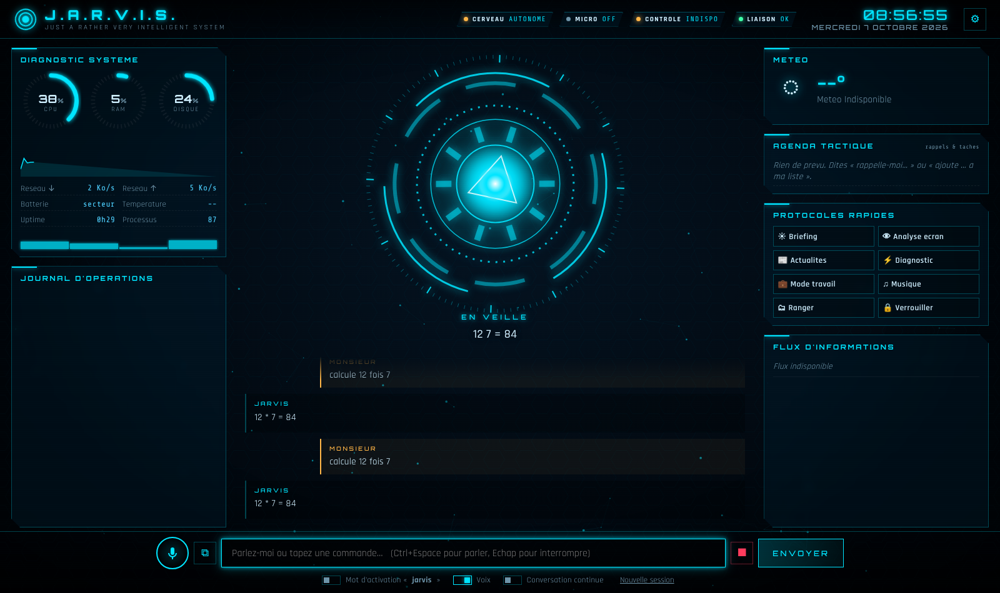

# J.A.R.V.I.S. — Just A Rather Very Intelligent System

Votre assistante IA personnelle, inspirée d'Iron Man : une interface holographique, une **voix féminine neurale**, la conversation **à la voix ou au clavier**, et la **prise de contrôle du PC** (applications, fichiers, souris, clavier, écran…). Le cerveau est **Claude** (Anthropic).



## Démarrage rapide

1. Installez **Python 3.10+** ([python.org](https://www.python.org/downloads/), cochez « Add Python to PATH ») et **Google Chrome** ou **Microsoft Edge** (nécessaires pour la reconnaissance vocale).
2. Lancez :
   - **Windows** : double-cliquez sur `start_windows.bat`
   - **macOS / Linux** : `./start.sh`
3. L'interface s'ouvre dans une fenêtre dédiée (`http://127.0.0.1:8777`).
4. Ouvrez les **réglages ⚙** et collez votre **clé API Anthropic** (à créer sur [platform.claude.com](https://platform.claude.com)). Vous pouvez aussi la mettre dans le fichier `.env` (`ANTHROPIC_API_KEY=...`).

Sans clé, JARVIS fonctionne en **mode autonome** : commandes de base (ouvre, ferme, météo, volume, joue, cherche, minuteur, note, calcule…) sans IA.

Installation manuelle : `pip install -r requirements.txt` puis `python run.py` (`--no-browser`, `--port 9000`).

## Parler à JARVIS

| Action | Comment |
|---|---|
| Parler une fois | Bouton micro, clic sur le réacteur, ou **Ctrl+Espace** |
| Mains libres | Activez « Mot d'activation » puis dites **« Jarvis, … »** |
| Conversation continue | JARVIS se remet à écouter après chaque réponse |
| Interrompre | **Échap** ou ■ (vous pouvez aussi lui couper la parole en parlant) |
| Montrer une image | Glissez-déposez, collez (Ctrl+V) ou bouton ⧉ |
| Valider une action sensible | Bouton, ou dites « oui » / « non » |

## Ce que JARVIS sait faire (45 outils + recherche web + contrôle de l'écran)

- **Prise de contrôle totale** : JARVIS voit l'écran, clique, tape, fait défiler, zoome — il peut remplir un formulaire ou piloter n'importe quelle application. *Arrêt d'urgence : placez la souris dans un coin de l'écran.*
- **Applications & web** : ouvrir/fermer des logiciels (Chrome, Word, Spotify, Discord, VS Code…), ouvrir des sites, rechercher (Google, YouTube, Maps, Amazon…), lancer directement une musique YouTube ou Spotify, gérer les fenêtres et bureaux virtuels.
- **Système** : diagnostic complet (CPU, RAM, disque, GPU, température, batterie, réseau, ping, IP), processus, volume, luminosité, veille, verrouillage, extinction/redémarrage programmés.
- **Fichiers** : lister, chercher (nom ou contenu), lire (txt, code, PDF, DOCX), écrire, copier, déplacer, renommer, supprimer (corbeille).
- **Automatisation** : commandes PowerShell/bash, scripts Python, clavier, presse-papiers, **routines** (« mode travail », « je pars »…) créées à la voix.
- **Informations précises en temps réel** : recherche web avec sources, météo détaillée + qualité de l'air, actualités par rubrique, bourse, cryptos, devises, Wikipédia, heure mondiale, calculatrice exacte.
- **Productivité** : rappels et minuteurs **annoncés à voix haute**, liste de tâches, bloc-notes, **mémoire à long terme** (il retient vos préférences d'une session à l'autre).
- **Vision** : analyse de l'écran ou des images que vous lui donnez.
- **Interface** : panneaux holographiques (tableaux, code, graphiques), 4 thèmes (Arc, Mark III, Stealth, Vibranium), effets sonores, séquence de démarrage, briefing matinal.

## Sécurité

- 3 niveaux d'**autonomie** : *Prudent* (tout est validé), *Normal* (suppression, extinction, shell… sont validés), *Total*.
- Le serveur n'écoute que sur `127.0.0.1` et refuse les connexions venant d'autres sites web.
- Le contenu des pages web / fichiers est traité comme une donnée, jamais comme un ordre.
- Données locales dans `data/` (réglages, mémoire, notes, rappels). La clé API reste sur votre machine.

## Réglages utiles

- **Modèle** : Claude Opus 5.5 (par défaut, le plus intelligent), Sonnet 5.5 (rapide), Haiku 4.5 (économique, sans contrôle de l'écran).
- **Réflexion** : « Rapide » par défaut pour une voix réactive ; montez à « Approfondi » pour les tâches complexes.
- **Voix** : Denise, Vivienne, Eloise (FR), Sylvie (QC), Sonia (UK, style FRIDAY)… + débit, hauteur et effet holographique.
- Un **repli automatique** de modèle est activé : si un filtre de sécurité refuse une demande à tort, l'API la relance sur un modèle de secours.

## Architecture

```
run.py               lancement (serveur + fenêtre)
jarvis/brain.py      cerveau : boucle Claude en streaming, outils, contrôle écran, confirmations, voix
jarvis/tools/        45 outils (système, applis, fichiers, shell, contrôle, médias, web, productivité, HUD)
jarvis/computer.py   captures d'écran + exécution souris/clavier (computer use)
jarvis/voice.py      synthèse vocale neurale (edge-tts), découpage en phrases
jarvis/offline.py    mode autonome sans clé
jarvis/server.py     FastAPI + WebSocket
web/                 interface HUD (HTML/CSS/JS, sans dépendance)
tests/               python -m pytest -q
```
